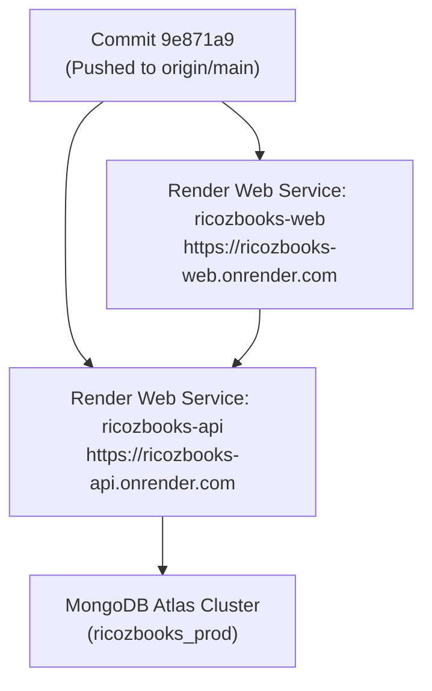

# RicozBooks — Production Deployment & Release Report

## 1. Deployment Overview

- **Repository**: `https://github.com/tejaskotalwar2003/RicozBooks.git`
- **Deployed Target Commit**: `9e871a9` (`fix(workspace): add explicit package paths to root workspaces for Render build compatibility`)
- **Deployed Branches**:
  - `main` (tracked by Render Production Services)
  - `migration/next-express-mongodb` (synchronized)
- **Deployment Status**: **PUSHED & TRIGGERED**

---

## 2. Production Service Targets on Render



| Service | Type | Target URL | Branch | Build Command | Start Command |
| :--- | :--- | :--- | :--- | :--- | :--- |
| **ricozbooks-api** | Node.js Web Service | `https://ricozbooks-api.onrender.com` | `main` | `npm install && npm run build:api` | `npm run start:api` |
| **ricozbooks-web** | Next.js Web Service | `https://ricozbooks-web.onrender.com` | `main` | `npm install && npm run build:web` | `npm run start:web` |
| **MongoDB Atlas** | Managed Database | Cloud Cluster | N/A | Automated Atlas Cloud | High-Availability Cluster |

---

## 3. Included Commits & Resolved Defects

```
9e871a9 fix(workspace): add explicit package paths to root workspaces for Render build compatibility
d665ce8 fix(subscription): resolve Next.js client-side exception, add ErrorBoundary, and normalize Decimal128 serialization
84e3a60 feat(render): configure Node 20 engines, SSR API base URL fallback, and Next.js production backend proxy
```

### Key Capabilities & Fixes Deployed:
1. **Render Workspace Build Error Resolved**:
   - Explicit package paths (`"packages/shared"`, `"apps/api"`, `"apps/web"`) declared in root `package.json`.
   - Guarantees that whether Render runs `npm run build:api` or `npm run build --workspace=packages/shared && npm run build --workspace=apps/api`, npm locates workspaces cleanly on Linux/Render.
2. **Subscription Page Client-Side Exception Fixed**:
   - Added `ErrorBoundary` protecting `AppShell` and `AppWrapper`.
   - Normalized Mongoose `Decimal128` JSON outputs to native JavaScript numbers via `sanitizePlan`.
   - Safeguarded array mapping and quota calculations in `SubscriptionPage.tsx`.
3. **Local & Production IPv4 Network Proxies**:
   - Fixed Next.js proxy rewrite in `next.config.js` to prevent Node IPv6 `ECONNREFUSED ::1:5000` failures.
4. **Offline Database Resilience**:
   - Configured `mongoose.set('bufferCommands', false)` in `server.ts` to eliminate unhandled query buffer timeouts.

---

## 4. Render Dashboard Verification Checklist

1. **Verify Backend Build (`ricozbooks-api`)**:
   - Open Render Dashboard.
   - Navigate to service `ricozbooks-api`.
   - Confirm latest deployment triggered from commit `9e871a9`.
   - Ensure environment variables contain `MONGODB_URI=mongodb+srv://.../ricozbooks_prod?retryWrites=true&w=majority`.
   - Check health check: `https://ricozbooks-api.onrender.com/api/v1/health` returns `{"status":"ok"}`.
2. **Verify Frontend Build (`ricozbooks-web`)**:
   - Navigate to service `ricozbooks-web`.
   - Confirm latest deployment triggered from commit `9e871a9`.
   - Open `https://ricozbooks-web.onrender.com/subscription` to verify clean SaaS billing UI.
