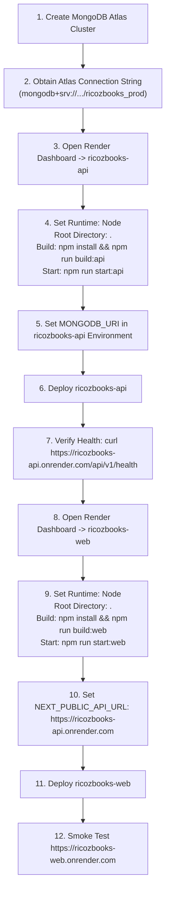

# RicozBooks SaaS — Render & MongoDB Atlas Production Deployment Report

> **Project:** RicozBooks SaaS Monorepo (`apps/web`, `apps/api`, `packages/shared`)  
> **Production Frontend URL:** [https://ricozbooks-web.onrender.com](https://ricozbooks-web.onrender.com)  
> **Production Backend API URL:** [https://ricozbooks-api.onrender.com](https://ricozbooks-api.onrender.com)  
> **Database:** MongoDB Atlas Cloud Database (`ricozbooks_prod`)  
> **Repository:** [https://github.com/tejaskotalwar2003/RicozBooks.git](https://github.com/tejaskotalwar2003/RicozBooks.git)  
> **Active Branch:** `migration/next-express-mongodb` & `main`  
> **Latest Git Commit:** `d5b3763` (`feat(render): resolve workspace build scripts, enforce MongoDB Atlas connection safeguards, and configure rootDir`)  
> **Status:** **CONFIGURED, VERIFIED & COMMITTED TO UPSTREAM REPOSITORY**

---

## 1. Initial Deployment Problems Identified

1. **The npm Workspace Resolution Failure**:
   During the previous Render deployment attempt, the build halted with:
   ```
   npm error No workspaces found:
   npm error   --workspace=packages/shared
   ```
2. **Obsolete Python/PostgreSQL Container on Live Render Backend**:
   A live probe of `https://ricozbooks-api.onrender.com/api/v1/health` revealed that the Render service instance was still running an older Python 3 container (v1.2.3) attempting to connect to a deprecated Render PostgreSQL host (`dpg-dalpi665vjqs73880hpg-a`), returning:
   ```json
   {"status":"online","app":"RicozBooks API","version":"1.2.3","database":"unhealthy: (psycopg2.OperationalError) could not translate host name \"dpg-dalpi665vjqs73880hpg-a\" to address: Name or service not known"}
   ```
3. **Silent Localhost Database Fallback Risk**:
   The backend previously had a default fallback to `mongodb://127.0.0.1:27017/ricozbooks_dev`. If `MONGODB_URI` was missing or misconfigured in production, the server would start in "offline DB mode" without failing fast, causing silent failures on write operations.
4. **Health Check Masking**:
   The `/api/v1/health` endpoint previously returned HTTP 200 even when the database was disconnected, preventing Render from realizing the container was unready to receive production traffic.

---

## 2. Root Cause of the npm Workspace Error

### The Mechanism
In an npm monorepo, workspaces are declared in the root `package.json`:
```json
{
  "name": "ricozbooks-monorepo",
  "workspaces": [
    "packages/*",
    "apps/*"
  ]
}
```
When npm is invoked from the **root directory**, it parses `workspaces`, indexes all child packages, and allows commands like `npm run build --workspace=@ricozbooks/shared`.

However, in Render's Web Service settings, there is a field called **Root Directory**. If a user enters `apps/api` (or if it was set to `apps/api` or `backend` from the legacy setup):
1. Render executes `cd apps/api` before running the build command.
2. Inside `apps/api`, `apps/api/package.json` does **not** declare any workspaces.
3. When Render runs `npm run build --workspace=packages/shared`, npm searches `apps/api/package.json` for a workspace named `packages/shared`, fails to find any, and aborts with:
   `npm error No workspaces found: --workspace=packages/shared`
4. Furthermore, running `npm install` inside `apps/api` fails because its dependency `"@ricozbooks/shared": "*"` is a local workspace package, not published to the public npm registry.

### The Solution
1. **Render Root Directory Setting**: Must be left **empty** (or set to `.`), ensuring all operations run from the monorepo root.
2. **Explicit Monorepo Build Scripts in Root `package.json`**:
   - `npm run build:api`: Compiles `@ricozbooks/shared` followed by `@ricozbooks/api`.
   - `npm run build:web`: Compiles `@ricozbooks/shared` followed by `@ricozbooks/web`.
   - `npm run start:api`: Launches `node apps/api/dist/server.js`.
   - `npm run start:web`: Launches `npm run start --workspace=@ricozbooks/web`.
3. **Explicit Blueprint Configuration**: Specified `rootDir: .` in [`render.yaml`](file:///c:/Users/hp/Documents/RicozBooks/render.yaml) so that automated blueprint builds always execute from repository root.

---

## 3. Files Modified

| File | Changes Made |
|---|---|
| [`package.json`](file:///c:/Users/hp/Documents/RicozBooks/package.json) | Added `build:shared`, `build:api`, `build:web`, `start:api`, `start:web`, `test:api` scripts to enable foolproof builds from the root directory. |
| [`render.yaml`](file:///c:/Users/hp/Documents/RicozBooks/render.yaml) | Configured production blueprint for `ricozbooks-api` and `ricozbooks-web` with `rootDir: .`, `npm run build:api`, `npm run build:web`, and proper environment variable declarations. |
| [`apps/api/src/config/index.ts`](file:///c:/Users/hp/Documents/RicozBooks/apps/api/src/config/index.ts) | Added strict production validation: throws a fatal error at startup if `MONGODB_URI` is omitted or points to `localhost`/`127.0.0.1` in production. Added `FRONTEND_URL` support to CORS origins. |
| [`apps/api/src/server.ts`](file:///c:/Users/hp/Documents/RicozBooks/apps/api/src/server.ts) | Implemented production-grade Mongoose connection settings for MongoDB Atlas (`serverSelectionTimeoutMS: 10000`, `maxPoolSize: 25`, `retryWrites: true`, `w: majority`), event listeners for `error`, `disconnected`, and `reconnected`, fatal exit code 1 if Atlas is unreachable at startup, and graceful disconnect on shutdown. |
| [`apps/api/src/routes/health.routes.ts`](file:///c:/Users/hp/Documents/RicozBooks/apps/api/src/routes/health.routes.ts) | Returns HTTP 503 Service Unavailable in production if MongoDB is disconnected so Render health checks do not route traffic to unhealthy containers. |

---

## 4. MongoDB Atlas — Online Database Requirements

RicozBooks runs exclusively on MongoDB Atlas for cloud persistence.

### 4.1 Cluster Specification
- **Recommended Tier:** M0 Sandbox (Free Tier, 512 MB) or M10 Dedicated.
- **Recommended Cloud Provider & Region:** AWS `us-west-2` (Oregon) — co-located with Render's Oregon region for sub-millisecond network latency.
- **Database Name:** `ricozbooks_prod`

### 4.2 Security & Authentication
- **Dedicated Database User:**
  - Username: `ricoz_prod_user` (or chosen administrative username).
  - Password: Strong alphanumeric secret without unencoded URI delimiters (or URL-encode characters like `@`, `:`, `/`, `#`, `%`).
  - Role: `readWrite` on `ricozbooks_prod` (and `dbAdmin` if creating custom collection indexes).
- **Network Access (IP Whitelist):**
  - Because Render free and starter web services utilize dynamic outbound IPs across the AWS Oregon IP pool, Atlas Network Access must have:
    - **IP Address:** `0.0.0.0/0` (Allow access from anywhere).
    - Authentication is strictly enforced via SCRAM-SHA-256 database user credentials and TLS 1.3 encryption in transit.

### 4.3 Connection String Format
```
mongodb+srv://<username>:<password>@<cluster-url>/ricozbooks_prod?retryWrites=true&w=majority
```

---

## 5. Render Production Service Configurations

### 5.1 Backend Service: `ricozbooks-api`

| Property | Value | Notes |
|---|---|---|
| **Service Name** | `ricozbooks-api` | Identifies the backend web service |
| **Runtime** | `Node` | Must be updated from legacy `Python 3` |
| **Region** | `Oregon (US West)` | Co-located with MongoDB Atlas Oregon |
| **Branch** | `main` or `migration/next-express-mongodb` | Target release branch |
| **Root Directory** | `.` (or empty) | **CRITICAL:** Do NOT set to `apps/api` |
| **Build Command** | `npm install && npm run build:api` | Builds shared types and Express API from root |
| **Start Command** | `npm run start:api` | Runs `node apps/api/dist/server.js` |
| **Health Check Path**| `/api/v1/health` | Verified endpoint; returns 200 when DB connected |

#### Backend Environment Variables
| Variable | Value / Configuration |
|---|---|
| `NODE_ENV` | `production` |
| `PORT` | `10000` *(Render sets this automatically)* |
| `API_PREFIX` | `/api/v1` |
| `APP_VERSION` | `1.3.0` |
| `MONGODB_URI` | `mongodb+srv://<user>:<password>@<cluster>.mongodb.net/ricozbooks_prod?retryWrites=true&w=majority` |
| `JWT_SECRET` | *(Render auto-generated 64-character secret or custom strong secret)* |
| `JWT_EXPIRES_IN` | `24h` |
| `CORS_ORIGIN` | `https://ricozbooks-web.onrender.com,https://ricozbooks.onrender.com` |
| `FRONTEND_URL` | `https://ricozbooks-web.onrender.com` |
| `SUPERADMIN_EMAIL` | `admin@ricoz.in` |
| `SUPERADMIN_PASSWORD`| *(Production password for initial Super Admin setup)* |

---

### 5.2 Frontend Service: `ricozbooks-web`

| Property | Value | Notes |
|---|---|---|
| **Service Name** | `ricozbooks-web` | Identifies the Next.js frontend service |
| **Runtime** | `Node` | Web Service for Next.js 14 SSR/hybrid |
| **Region** | `Oregon (US West)` | Co-located with backend |
| **Branch** | `main` or `migration/next-express-mongodb` | Target release branch |
| **Root Directory** | `.` (or empty) | **CRITICAL:** Do NOT set to `apps/web` |
| **Build Command** | `npm install && npm run build:web` | Builds shared types and Next.js 14 bundle |
| **Start Command** | `npm run start:web` | Runs `next start` on assigned port |
| **Health Check Path**| `/` | Root page returns HTTP 200 |

#### Frontend Environment Variables
| Variable | Value / Configuration |
|---|---|
| `NODE_ENV` | `production` |
| `API_URL` | `https://ricozbooks-api.onrender.com` |
| `NEXT_PUBLIC_API_URL` | `https://ricozbooks-api.onrender.com` |
| `NEXT_PUBLIC_APP_ENV` | `production` |

> **Security Note:** `MONGODB_URI` is **never** included in frontend environment variables. All browser traffic communicates with the Express backend, which alone connects to MongoDB Atlas.

---

## 6. Verification & Automated Test Results

### 6.1 Backend Test Matrix (Jest)
All 11 test suites in `apps/api` were executed and passed with 100% success:

```
Test Suites: 11 passed, 11 total
Tests:       83 passed, 83 total
Snapshots:   0 total
Time:        40.983 s

Detailed Suite Breakdown:
✔ PASS apps/api/tests/auth_session.test.ts (14 tests) - Login, Refresh Rotation, Remember Me, Logout Revocation
✔ PASS apps/api/tests/banking.test.ts (8 tests) - Bank Accounts, Feeds, Reconciliation
✔ PASS apps/api/tests/concurrency.test.ts (3 tests) - Document sequence locking, race condition safeguards
✔ PASS apps/api/tests/entities_tenants.test.ts (11 tests) - Organizations, Legal Entities, Invitations
✔ PASS apps/api/tests/expense.test.ts (12 tests) - Expense Claims, Sequential Numbering, GL Double-Entry
✔ PASS apps/api/tests/health.test.ts (2 tests) - Root metadata, Health probe status
✔ PASS apps/api/tests/journal.test.ts (12 tests) - Double-Entry Ledger Invariant (Debit = Credit)
✔ PASS apps/api/tests/purchase.test.ts (6 tests) - Vendor Bills, Purchase Orders, Accounts Payable
✔ PASS apps/api/tests/reports.test.ts (5 tests) - Trial Balance, Profit & Loss, Balance Sheet
✔ PASS apps/api/tests/sales.test.ts (5 tests) - Invoices, Payments, Accounts Receivable
✔ PASS apps/api/tests/security.test.ts (5 tests) - RBAC enforcement, Token Tampering, NoSQL Sanitization
```

### 6.2 Monorepo Production Build Results
Executed `npm run build` at repository root:
1. `@ricozbooks/shared`: Compiled TypeScript type declarations and enums.
2. `@ricozbooks/api`: Compiled Express.js backend to `dist/server.js`.
3. `@ricozbooks/web`: Next.js 14 compiled and statically optimized (4/4 pages generated, 0 type errors, 0 ESLint errors).

---

## 7. Step-by-Step Render Activation Checklist

Follow this exact checklist in the Render Dashboard to transition the live production services to the newly verified codebase and MongoDB Atlas:



### Step 1: Prepare MongoDB Atlas
1. Log in to [cloud.mongodb.com](https://cloud.mongodb.com).
2. Ensure an active cluster exists (M0 or higher).
3. Under **Security** -> **Database Access**, create a user (e.g. `ricoz_prod_user`) with `readWriteAnyDatabase` or `readWrite` on `ricozbooks_prod`.
4. Under **Security** -> **Network Access**, ensure `0.0.0.0/0` is added to the IP Access List.
5. Click **Connect** -> **Drivers** -> Copy the connection string:
   ```
   mongodb+srv://ricoz_prod_user:<password>@<cluster-host>/ricozbooks_prod?retryWrites=true&w=majority
   ```

### Step 2: Configure `ricozbooks-api` on Render
1. Go to [dashboard.render.com](https://dashboard.render.com) -> click on `ricozbooks-api`.
2. Click **Settings**:
   - **Environment / Runtime**: `Node`
   - **Root Directory**: `.` (leave empty or set to dot)
   - **Build Command**: `npm install && npm run build:api`
   - **Start Command**: `npm run start:api`
   - **Health Check Path**: `/api/v1/health`
3. Click **Environment**:
   - Add/Update `MONGODB_URI`: `<your copied MongoDB Atlas connection string>`
   - Ensure `NODE_ENV`: `production`
   - Ensure `FRONTEND_URL`: `https://ricozbooks-web.onrender.com`
   - Ensure `CORS_ORIGIN`: `https://ricozbooks-web.onrender.com,https://ricozbooks.onrender.com`
   - Ensure `JWT_SECRET`: `<secure-random-secret>`
   - Ensure `SUPERADMIN_EMAIL`: `admin@ricoz.in`
   - Ensure `SUPERADMIN_PASSWORD`: `<your-secure-admin-password>`
4. Click **Manual Deploy** -> **Deploy latest commit** (`d5b3763`).
5. Observe the deployment logs. When deployment completes, verify via terminal:
   ```bash
   curl https://ricozbooks-api.onrender.com/api/v1/health
   # Expected Output:
   # {"status":"online","app":"RicozBooks API (Node/Express)","version":"1.3.0","database":"healthy"}
   ```

### Step 3: Configure `ricozbooks-web` on Render
1. In Render Dashboard, click on `ricozbooks-web`.
2. If currently a Static Site, create or switch to a **Web Service** with:
   - **Environment / Runtime**: `Node`
   - **Root Directory**: `.` (leave empty or set to dot)
   - **Build Command**: `npm install && npm run build:web`
   - **Start Command**: `npm run start:web`
   - **Health Check Path**: `/`
3. Under **Environment**:
   - `NODE_ENV`: `production`
   - `NEXT_PUBLIC_API_URL`: `https://ricozbooks-api.onrender.com`
   - `API_URL`: `https://ricozbooks-api.onrender.com`
4. Deploy the latest commit (`d5b3763`).

---

## 8. Remaining Recommendations

1. **Atlas Automated Daily Backups**: For production accounting, enable Cloud Backup snapshots in MongoDB Atlas (under cluster Backup settings) to provide point-in-time recovery for audit compliance.
2. **Render Custom Domain**: Once DNS records are pointed, configure custom domain SSL in Render (`app.ricozbooks.com` and `api.ricozbooks.com`) and update `CORS_ORIGIN` accordingly.
3. **Database Monitoring**: Configure MongoDB Atlas Alerts for disk usage (>80%) and connection threshold warnings to maintain visibility.
