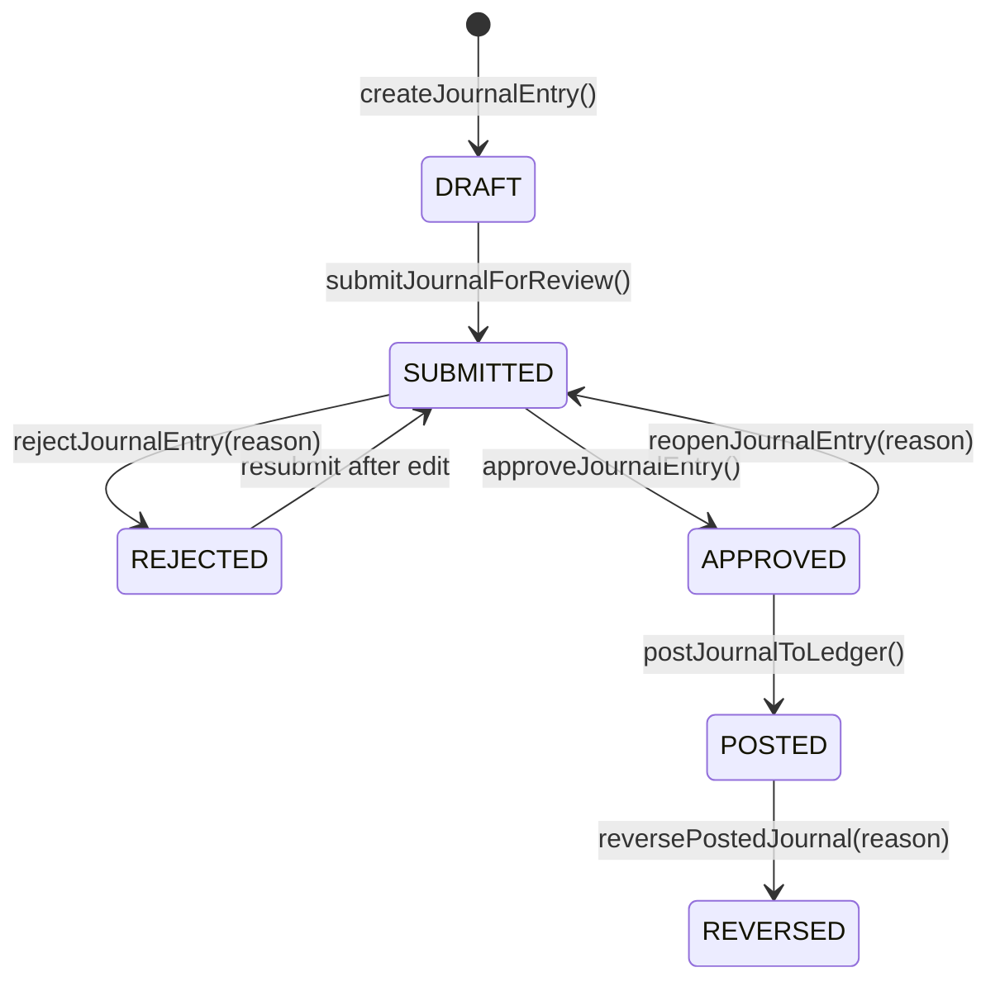

# RicozBooks — Accounting Engine & Financial Workflows Report

## 1. Executive Summary

This report documents the architectural implementation and mathematical verification of the **General Ledger & Financial Workflow Engine** for the target Node.js + Express.js + MongoDB stack (`@ricozbooks/api`), migrated under branch `migration/next-express-mongodb`.

The implementation preserves 100% of the accounting principles, double-entry invariants, maker-checker authorization lifecycles, and Indian statutory GST rules established in the original Python/FastAPI implementation, while adopting MongoDB's native multi-document transactional capabilities, compound multi-tenant indexing, and IEEE 754-2008 `Decimal128` monetary representations.

---

## 2. Double-Entry General Ledger Invariant Architecture

### 2.1 Double-Entry Balance Equation
Every journal entry committed to the General Ledger must satisfy the fundamental accounting invariant:

$$\sum_{i=1}^{n} \text{Debit}_i = \sum_{i=1}^{n} \text{Credit}_i \quad \text{where} \quad |\sum \text{Debit} - \sum \text{Credit}| \le 0.001$$

The engine implements this in `AccountingEngine.validateJournalBalance()` with five mandatory enforcement rules:
1. **Minimum Lines**: Every journal entry must have at least 2 lines ($n \ge 2$). Single-line entries are rejected with HTTP 400.
2. **Non-Negativity**: Negative amounts are strictly prohibited. Debits and credits must be $\ge 0.00$. Any line with $\text{Debit} < 0$ or $\text{Credit} < 0$ is rejected.
3. **Single Directionality**: A single line cannot have both $\text{Debit} > 0$ and $\text{Credit} > 0$. Each line represents a unidirectional debit or credit to a specific Chart of Accounts (COA) code.
4. **Non-Zero Lines**: A line cannot have both $\text{Debit} = 0$ and $\text{Credit} = 0$. At least one side must be positive.
5. **Strict Positive Total**: The overall total debit of the journal entry must be strictly greater than zero ($\sum \text{Debit} > 0.00$).

### 2.2 Period Lock Enforcement (`validatePeriodOpen`)
Before any journal entry can be drafted, submitted, approved, posted, or reversed, the engine validates that the transaction date does not fall within a closed or locked accounting period:
- **Statutory Fiscal Period Lock**: Verifies `FiscalPeriod` collection for `entity_id` where `start_date <= entry_date <= end_date` and `is_closed == true`.
- **Management Monthly Close Lock**: Verifies `ClosePeriod` collection for `entity_id` and `month == entry_date.month` where `status == "CLOSED"`.

---

## 3. Maker-Checker Lifecycle & Approval Workflow

The journal entry lifecycle enforces strict segregation of duties (SoD) between entry preparers and accounting supervisors:

1. **DRAFT**: Created by accountants. Modifiable. Balance and period open checked at creation.
2. **SUBMITTED**: Submitted for review. Locked against inline modification.
3. **APPROVED**: Reviewed and approved by accounting manager/reviewer.
4. **REJECTED**: Rejected back to preparer. Mandatory reason string recorded in audit trail and entry metadata.
5. **REOPENED**: An approved but unposted entry can be returned to `SUBMITTED` for corrections with a mandatory reason.
6. **POSTED**: Atomic ledger posting. Immutable. Only approved entries can be posted by reviewers (or direct posting by super administrators).
7. **REVERSED**: Posted entries cannot be deleted or reopened. Corrections require generating an exact reversing entry (`REV-YYYY-XXXX`) where original debits become credits and original credits become debits. The original entry is marked `REVERSED`.

---

## 4. Sales Invoicing, GST & Inventory/COGS Posting

The `SalesEngine` links invoicing, statutory taxation, and perpetual inventory management into balanced General Ledger postings:

### 4.1 Statutory GST Rules
- **Intra-State Supply**: When seller entity state equals customer state:
  - Line CGST: $\text{Line Subtotal} \times \frac{\text{Tax Rate}}{2 \times 100}$
  - Line SGST: $\text{Line Subtotal} \times \frac{\text{Tax Rate}}{2 \times 100}$
- **Inter-State Supply**: When seller entity state differs from customer state:
  - Line IGST: $\text{Line Subtotal} \times \frac{\text{Tax Rate}}{100}$

### 4.2 Balanced Invoicing GL Transaction
When an invoice is posted:
1. **Debit**: Accounts Receivable (`1200`, Asset) for Grand Total ($\text{Subtotal} + \text{Taxes}$).
2. **Credit**: Operating Sales Revenue (`4000`, Revenue) for Taxable Subtotal.
3. **Credit**: Statutory CGST Output (`2100`, Liability) for CGST Total.
4. **Credit**: Statutory SGST Output (`2110`, Liability) for SGST Total.
5. **Credit**: Statutory IGST Output (`2120`, Liability) for IGST Total.

### 4.3 Automated Perpetual Inventory & COGS (`5700` & `1300`)
For items with `track_inventory == true`:
- Stock availability is verified prior to posting. If $\text{Current Stock} < \text{Requested Quantity}$, posting is aborted with HTTP 400.
- Unit valuation is determined using moving purchase cost: $\text{Unit Cost} = \text{purchase\_price} > 0 \ ? \ \text{purchase\_price} : \text{opening\_stock\_rate}$.
- **Debit**: Cost of Goods Sold (`5700`, Expense) for $\text{Quantity} \times \text{Unit Cost}$.
- **Credit**: Merchandise Inventory Asset (`1300`, Asset) for $\text{Quantity} \times \text{Unit Cost}$.
- **Stock Decrement**: `Product.current_stock` is atomically decremented by `quantity`.
- **Inventory Movement**: An immutable `InventoryMovement` record is written with type `SALE`.

---

## 5. Purchase Bills & Vendor AP Accounting

The `PurchaseEngine` handles procurement, input tax credits (ITC), and accounts payable:
1. **Debit**: Operating & Purchase Expenses (`5000`, Expense) or Merchandise Inventory (`1300`, Asset).
2. **Debit**: Input GST Tax Credit (`1400`, Asset) for eligible input tax credits.
3. **Credit**: Accounts Payable (`2000`, Liability) for invoice grand total.
4. **Inventory Inflow**: For tracked items, `Product.current_stock` is incremented and an `InventoryMovement` of type `PURCHASE` is recorded.
5. **Vendor Disbursement**: When a vendor payment is made, Accounts Payable (`2000`) is debited and Bank/Cash (`1100`) is credited.

---

## 6. Banking & Automated Statement Reconciliation

The `BankingEngine` coordinates bank accounts, cash transactions, and statement reconciliation:
- **GL Integration**: Each bank account is linked to an Asset General Ledger account (`1100 Cash and Cash Equivalents`).
- **Transaction Tracking**: Deposits (inflow/credit) increment account balance; withdrawals (outflow/debit) decrement account balance.
- **Automated Matching**: Statement lines are automatically reconciled against unreconciled book transactions by matching exact amount and direction.
- **Zero-Difference Lock**: Reconciliation cannot be marked `COMPLETED` unless the difference between the statement ending balance and the reconciled book balance is exactly $0.00$.

