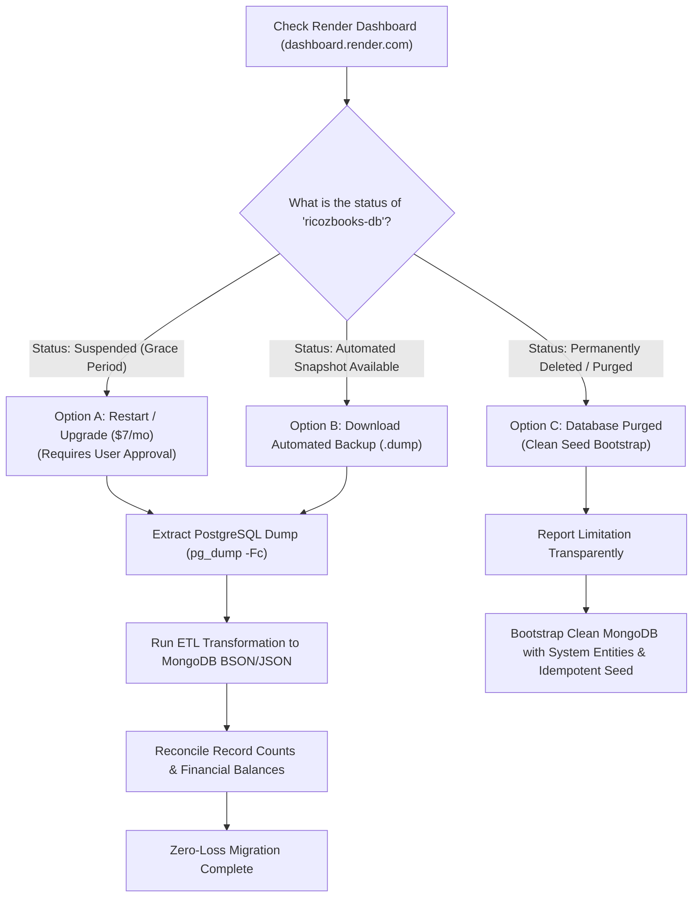

# RICOZBOOKS — Database Recovery Plan & Data Migration Strategy

**Document Version:** 1.0.0  
**Phase:** Phase 1 Deliverable  
**Target Database:** MongoDB (MongoDB Atlas Free Tier / Replica Set)  
**Source Database:** Render Managed PostgreSQL (`ricozbooks-db`)  
**Core Invariant:** Zero data loss, zero fabricated records, explicit approval gates for any paid recovery.

---

## 1. Verified Production Database Status

### 1.1 Live Diagnostic Evidence
A live HTTP health query executed against the deployed backend service returned:
```bash
curl.exe -s --max-time 15 https://ricozbooks-api.onrender.com/api/v1/health
```

**Response Payload:**
```json
{
  "status": "online",
  "app": "RicozBooks API",
  "version": "1.2.3",
  "database": "unhealthy: (psycopg2.OperationalError) could not translate host name \"dpg-dalpi665vjqs73880hpg-a\" to address: Name or service not known\n\n(Background on this error at: https://sqlalche.me/e/21/e3q8)"
}
```

### 1.2 Root Cause Analysis
1. **Host Deregistration:** The hostname `dpg-dalpi665vjqs73880hpg-a` is Render's internal DNS alias for PostgreSQL instance `ricozbooks-db`. Render returns `could not translate host name` when the internal DNS record no longer resolves.
2. **Render 30-Day Expiration Policy:** On Render's Free tier, managed PostgreSQL databases have an automatic 30-day lifecycle. Upon expiration:
   - The database instance is stopped and suspended.
   - Internal DNS (`dpg-...-a`) is unlinked.
   - External access is disabled.
3. **Repository State:** A recursive inspection of the local Git repository confirmed that **no local database snapshots (`.dump`, `.sql`, or `.sqlite` files) exist in source control**. Git version control protects application code and schemas, not live database volumes.

---

## 2. Recovery Scenarios & Decision Tree



---

## 3. Detailed Recovery Procedures

### Scenario A: Database in Suspended / Grace Period State
If the database was suspended within Render's standard retention window:
1. Log in to [Render Dashboard](https://dashboard.render.com).
2. Locate PostgreSQL instance `ricozbooks-db`.
3. If an "Unsuspend" or "Upgrade to Starter ($7/month)" button is available:
   > [!IMPORTANT]
   > **Approval Gate:** Upgrading to a paid Render plan costs \$7/month. In accordance with Absolute Rule #10, the developer **must not** upgrade or purchase paid services without explicit user approval.
4. If approved: Upgrade to Starter to immediately reactivate the database and re-enable DNS.
5. Once reactive, extract the full database dump immediately:
   ```bash
   pg_dump -Fc --no-acl --no-owner -h <EXTERNAL_HOST> -U ricoz_user -d ricozbooks_db > backups/ricozbooks_source_backup.dump
   ```

### Scenario B: Automated Backup Snapshot Available
Render often retains point-in-time snapshots under the **Backups** tab:
1. Check `ricozbooks-db` $\to$ **Backups** in Render Dashboard.
2. If a downloadable snapshot exists, download the `.dump` file to `backups/ricozbooks_snapshot.dump`.
3. Verify dump integrity using `pg_restore -l backups/ricozbooks_snapshot.dump`.

### Scenario C: Database Permanently Deleted (Zero Source Recovery)
If Render has purged the database volume:
1. In accordance with Absolute Rule #6 and Rule #11, **do not invent or fabricate historical transactions, invoices, or customer ledger records**.
2. Document the exact data boundary transparently:
   - Historical transactional records created during testing on Render are non-recoverable.
   - Core application structure, baseline Chart of Accounts (COGS 5700, GAAP hierarchy), default legal entities, 5 canonical departments, 47 granular permissions, standard roles, product catalog, and demo coordinator accounts are **100% defined in verified idempotent seed scripts** (`migrate_entities.py`, `seed.py`).
3. Bootstrap MongoDB using these verified system seeders, establishing a clean, compliant development and staging baseline.

---

## 4. PostgreSQL to MongoDB Transformation & Schema Mapping

When source data is recovered (or during initial schema initialization), relational tables map to MongoDB collections as follows:

| PostgreSQL Source Table | Target MongoDB Collection | Migration Strategy & Document Structure |
| :--- | :--- | :--- |
| `users`, `user_sessions` | `users`, `userSessions` | Embed user roles array; store sessions in TTL-indexed `userSessions`. |
| `departments` | `departments` | Store 5 canonical departments; embed member count references. |
| `roles`, `permissions`, `role_permissions` | `roles`, `permissions` | Embed permission codes array `['journals:create', 'sales:invoice:create']` directly inside role document. |
| `companies`, `entities`, `user_companies`, `user_entities` | `organizations`, `entities` | Embed company address & settings; link entities by `organizationId`. |
| `organization_invitations` | `invitations` | Single-use invitation documents with compound index `{ organizationId: 1, email: 1 }` and TTL on `expiresAt`. |
| `accounts` | `accounts` | Hierarchical account documents with `{ entityId: 1, code: 1 }` unique index. |
| `journal_entries`, `journal_entry_lines` | `journals` | **Embedded Document Pattern:** Embed `lines: [{ accountId, debit, credit, description, dimensionId }]` within each `journal` document to guarantee atomic single-document reads and balanced journal integrity. |
| `customers`, `vendors` | `customers`, `vendors` | Customer profile with embedded billing/shipping addresses, GSTIN, PAN, and balance caches. |
| `products` | `products` | Product catalog with SKU unique index `{ entityId: 1, sku: 1 }`, inventory tracking flags, and current stock. |
| `invoices`, `invoice_lines` | `invoices` | Embed invoice lines `[{ productId, quantity, unitPrice, taxRate, cgstAmount, sgstAmount, igstAmount, lineTotal }]`; store public payment token and payment history. |
| `bills`, `bill_lines` | `bills` | Embed bill lines; track approval and payment status. |
| `inventory_movements`, `stock_adjustments` | `inventoryMovements`, `stockAdjustments` | Append-only movement ledger with `{ entityId: 1, productId: 1, createdAt: -1 }` index. |
| `bank_accounts`, `bank_transactions`, `bank_reconciliations` | `bankAccounts`, `bankTransactions`, `bankReconciliations` | Bank accounts with balance cache; statement lines embedded or linked. |
| `gst_return_filings` | `gstReturns` | Periodic return filing documents with JSON payload summary. |
| `audit_logs` | `auditLogs` | Append-only audit documents with sanitized payloads and `{ timestamp: -1 }` index. |
| `demo_admin_users`, `demo_requests`, `demo_schedule_history` | `demoAdminUsers`, `demoRequests` | Independent collection isolated from customer tenant data. |

---

## 5. Monetary Precision & Double-Entry Integrity Rules

To preserve financial correctness in MongoDB:
1. **Monetary Representation:**
   - **Rule:** Never use floating-point types (`Double`) for currency or financial ledgers.
   - **Implementation:** Store currency amounts using `Decimal128` (via Mongoose `Schema.Types.Decimal128`) or integer minor units (paisa / cents: `amount * 100`).
2. **Double-Entry Balance Enforcement:**
   - On every journal entry save:
     $$\left| \sum \text{Debits} - \sum \text{Credits} \right| < 0.0001$$
   - Enforced by Mongoose document pre-save hook and database-level JSON schema validator.
3. **Atomic Multi-Document Transactions:**
   - All complex financial operations affecting multiple collections (e.g. posting an invoice that updates AR, Tax liability, Inventory stock, and COGS ledger) **must** execute inside an atomic MongoDB session:
     ```typescript
     const session = await mongoose.startSession();
     session.startTransaction();
     try {
       // 1. Update stock
       // 2. Post journal entry
       // 3. Mark invoice as POSTED
       await session.commitTransaction();
     } catch (err) {
       await session.abortTransaction();
       throw err;
     } finally {
       session.endSession();
     }
     ```

---

## 6. Financial Reconciliation & Acceptance Criteria

Prior to accepting any migrated database:
1. **Count Reconciliation:**
   - For every source table $T$: $\text{Count}(T_{\text{PostgreSQL}}) == \text{Count}(C_{\text{MongoDB}})$.
2. **Financial Balance Reconciliation:**
   - Verify that General Ledger debits equal credits across all accounts:
     $$\sum_{\text{all journals}} \text{Debit} == \sum_{\text{all journals}} \text{Credit}$$
3. **Trial Balance Verification:**
   - Compute Trial Balance from MongoDB and confirm it matches the source trial balance down to 0.00 currency units.
4. **Exception Logging:**
   - Any unmapped, corrupted, or orphaned record must be logged to `docs/migration/DATA_MAPPING_AND_RECONCILIATION.md` with zero silent omissions.

