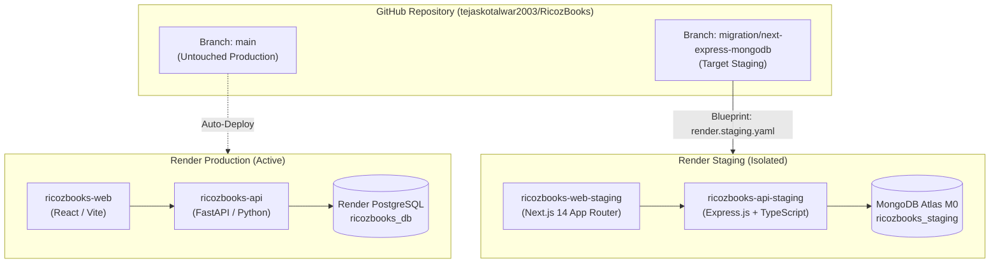

# RicozBooks — Deployment & Zero-Downtime Rollback Procedure

**Document Version:** 1.0.0  
**Phase:** Phase 7 — Staging Deployment on Render  
**Dedicated Branch:** `migration/next-express-mongodb`  
**Latest Verified Commit:** `d0bbbd1`  
**Target Stack:** Next.js 14 (App Router) + Node.js/Express.js + MongoDB Atlas  

---

## 1. System Topology & Isolation Guarantee

The staging environment is deployed strictly as independent web services alongside the existing production services. 



### Safety Invariants:
1. **Branch Isolation:** Production auto-deploys exclusively from `main`. Staging builds exclusively from `migration/next-express-mongodb`.
2. **Database Isolation:** Production utilizes Render PostgreSQL. Staging utilizes a dedicated MongoDB Atlas M0 cluster (`ricozbooks_staging`). No cross-environment database connections exist.
3. **Domain Isolation:** Staging runs under separate URL origins:
   - Frontend: `https://ricozbooks-web-staging.onrender.com`
   - Backend API: `https://ricozbooks-api-staging.onrender.com`
4. **Data Protection:** No historical production records are migrated without explicit verification. Staging initializes from a clean, idempotent GAAP chart of accounts seed.

---

## 2. Blueprint Specification (`render.staging.yaml`)

Staging services are declared in [`render.staging.yaml`](file:///c:/Users/hp/Documents/RicozBooks/render.staging.yaml):

### 2.1 Backend API Service (`ricozbooks-api-staging`)
- **Type:** Web Service (Node runtime, Free tier, Oregon region)
- **Branch:** `migration/next-express-mongodb`
- **Build Command:**
  ```bash
  npm install && npm run build --workspace=packages/shared && npm run build --workspace=apps/api
  ```
- **Start Command:**
  ```bash
  node apps/api/dist/server.js
  ```
- **Health Check Path:** `/api/v1/health`
- **Environment Variables:**
  - `NODE_ENV`: `staging`
  - `PORT`: `8000` (Render overrides dynamically with `$PORT`)
  - `API_PREFIX`: `/api/v1`
  - `APP_VERSION`: `1.3.0`
  - `JWT_SECRET`: Render auto-generated (`generateValue: true`)
  - `JWT_EXPIRES_IN`: `24h`
  - `MONGODB_URI`: Set manually in Render dashboard pointing to MongoDB Atlas (`sync: false`)
  - `CORS_ORIGIN`: `https://ricozbooks-web-staging.onrender.com,http://localhost:3000`
  - `SUPERADMIN_EMAIL`: `admin@ricoz.in`
  - `SUPERADMIN_PASSWORD`: Render auto-generated (`generateValue: true`)

### 2.2 Frontend Web Service (`ricozbooks-web-staging`)
- **Type:** Web Service (Node runtime, Free tier, Oregon region)
- **Branch:** `migration/next-express-mongodb`
- **Build Command:**
  ```bash
  npm install && npm run build --workspace=packages/shared && npm run build --workspace=apps/web
  ```
- **Start Command:**
  ```bash
  npm run start --workspace=apps/web
  ```
- **Health Check Path:** `/`
- **Environment Variables:**
  - `NODE_ENV`: `production`
  - `API_URL`: `https://ricozbooks-api-staging.onrender.com`
  - `NEXT_PUBLIC_API_URL`: `https://ricozbooks-api-staging.onrender.com`
  - `NEXT_PUBLIC_APP_ENV`: `staging`

---

## 3. Step-by-Step Staging Deployment Procedure

### Step 1: Provision MongoDB Atlas M0 Cluster
1. Log in to [MongoDB Atlas Console](https://cloud.mongodb.com).
2. Create an **M0 Free Tier** cluster:
   - Cloud Provider: **AWS**
   - Region: **us-west-2 (Oregon)** (co-located with Render)
   - Cluster Name: `ricozbooks-staging-cluster`
3. Configure Database Access:
   - Add database user: `ricoz_staging_admin`
   - Grant role: `readWriteAnyDatabase` or scoped to `ricozbooks_staging`
   - Generate strong password.
4. Configure Network Access:
   - Add IP Access: `0.0.0.0/0` (Render free tier dynamic egress IPs)
5. Copy Connection String:
   ```text
   mongodb+srv://ricoz_staging_admin:<PASSWORD>@ricozbooks-staging-cluster.xxxx.mongodb.net/ricozbooks_staging?retryWrites=true&w=majority
   ```

### Step 2: Apply Blueprint in Render Dashboard
1. Log in to [Render Dashboard](https://dashboard.render.com).
2. Click **New +** $\to$ select **Blueprint**.
3. Connect repository: `tejaskotalwar2003/RicozBooks`.
4. Configure blueprint parameters:
   - **Branch:** `migration/next-express-mongodb`
   - **Blueprint File Path:** `render.staging.yaml`
5. Render will inspect the file and display `ricozbooks-api-staging` and `ricozbooks-web-staging`.
6. Set the required secret environment variable:
   - In `ricozbooks-api-staging` $\to$ paste the `MONGODB_URI` from Step 1.
7. Click **Apply**.

---

## 4. Initial Access & Secure Bootstrap Procedure

Upon starting up and connecting to MongoDB Atlas, `ricozbooks-api-staging` executes `SeedService.seedAll()`:
1. **Canonical Departments:** 5 operational departments provisioned (`FINANCE_ACCOUNTING`, `OPERATIONS`, `TECHNICAL_ENGINEERING`, `SALES_DEMO`, `CUSTOMER_SUPPORT`).
2. **Granular Permissions & Roles:** 47 permissions and 13 system roles initialized.
3. **Default Operating Workspace:** Organization `Ricoz Technologies Pvt Ltd` and legal entity `Ricoz Technologies (HQ)` with standard Chart of Accounts (COGS `5700`, Cash `1000`, Bank `1100`, AR `1200`, AP `2000`).
4. **Secure Super Admin Bootstrap:**
   - Account: `admin@ricoz.in`
   - Password: Automatically generated by Render via `generateValue: true`.
   - To retrieve initial password: View `ricozbooks-api-staging` $\to$ **Environment** in the Render Dashboard and inspect the generated `SUPERADMIN_PASSWORD` value.
5. **Demo Accounts Guard:** Demo users with trivial passwords (`admin123`) are **strictly excluded** in staging (`process.env.NODE_ENV === 'staging'`).

---

## 5. Zero-Downtime Rollback Procedure

Because staging runs on dedicated services completely separate from production, staging deployments carry **zero risk** of downtime for production users.

### Scenario A: Staging Deployment Anomaly or Failure
If a staging build fails or an error is detected during staging smoke tests:
1. **Immediate Action:** In the Render Dashboard, navigate to `ricozbooks-api-staging` and `ricozbooks-web-staging` $\to$ **Settings** $\to$ **Suspend Service**.
2. **Root Cause Analysis:** Inspect the build/runtime logs in Render.
3. **Code Fix:** Apply fix on branch `migration/next-express-mongodb`, verify locally, and push to GitHub.
4. **Resume Staging:** Click **Resume Service** in Render.

### Scenario B: Accidental Production Impact (Safety Boundary)
- Production `main` branch remains untouched at commit `b56ab44`.
- If any unintended setting is applied to production:
  1. Trigger immediate rollback in Render `ricozbooks-api` to previous successful deployment.
  2. Verify production health endpoint: `GET https://ricozbooks-api.onrender.com/api/v1/health`.
  3. Verify production web app: `GET https://ricozbooks.onrender.com`.

---

## 6. Pre-Cutover Verification Gate

Prior to any production cutover:
- [ ] Staging smoke tests passed (100% of scenarios in `STAGING_SMOKE_TEST_REPORT.md`).
- [ ] Staging database verified on MongoDB Atlas M0 replica set with transaction support.
- [ ] User review and explicit approval provided.
