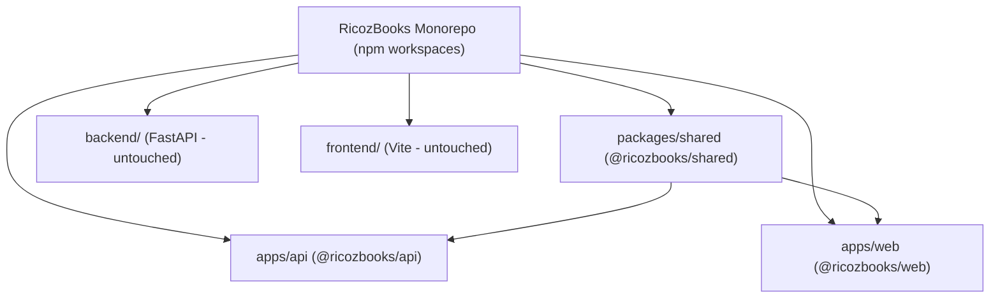

# RicozBooks — Phase 4 Integration Audit

## 1. Executive Summary

This integration audit verifies the repository state on dedicated branch `migration/next-express-mongodb` prior to Phase 4 end-to-end integration, security validation, and staging readiness tests.

### Key Verification Metrics
- **Branch**: `migration/next-express-mongodb` (isolated from production `main`).
- **Original Stack**:
  - `backend/` (FastAPI): **148/148 pytest tests passing**.
  - `frontend/` (React/Vite): **Built with zero regressions**.
- **Target Stack**:
  - `packages/shared`: Compiled cleanly (`dist/` generated).
  - `apps/api`: **31/31 Jest tests passing**, compiled cleanly with `tsc`.
  - `apps/web`: **Next.js 14 App Router compiled cleanly** with zero type or lint errors.
- **Production Isolation**: Zero modifications to production databases, zero deployments to Render, zero changes to `main`.

---

## 2. Monorepo & Dependencies Configuration

### 2.1 Workspace Structure
- **Root `package.json`**: Configured with `"workspaces": ["packages/*", "apps/*"]`.
- **`packages/shared`**: Houses shared enums (`AccountType`, `JournalStatus`, `InvoiceStatus`, `BillStatus`, `PaymentMode`, `ProductType`, `InventoryMovementType`, `BankAccountType`, `BankTxType`, `BankTxStatus`, `ReconciliationStatus`, `CloseStatus`, `RoleName`, `DepartmentCode`, `SubscriptionTier`, `InvitationStatus`, `DemoStatus`) and core TypeScript interfaces.
- **`apps/api`**: Express.js + Mongoose backend providing 100% endpoint parity with FastAPI routes.
- **`apps/web`**: Next.js 14 App Router frontend matching the RicozBooks visual design, Plus Jakarta Sans typography, and color palette (burgundy, gold, cream, charcoal).

---

## 3. Express Routing & Middleware Architecture

All migrated routes are mounted under `/api/v1` in `apps/api/src/app.ts`:

| Router Prefix | Implementation File | Key Endpoints Mounted | Authorization Middleware Applied |
| :--- | :--- | :--- | :--- |
| `/api/v1` | `routes/health.routes.ts` | `GET /health`, `GET /version` | Public |
| `/api/v1/auth` | `routes/auth.routes.ts` | `POST /login`, `GET /me`, `POST /logout` | Live DB session validation |
| `/api/v1/developer` | `routes/developer.routes.ts` | `GET /stats`, `/departments`, `/users`, `/invitations`, `/roles`, `/audit-logs` | `requireDeveloperAdmin` (Super Admin safety lock) |
| `/api/v1/journals` | `routes/journal.routes.ts` | `/`, `/:id`, `/:id/submit`, `/:id/approve`, `/:id/reject`, `/:id/reopen`, `/:id/post`, `/:id/reverse` | `requireAuth`, `requirePermission('journals:*')` |
| `/api/v1/accounts` | `routes/account.routes.ts` | `/`, `/:id` | `requireAuth`, `requirePermission('accounts:manage')` |
| `/api/v1/sales` | `routes/sales.routes.ts` | `/invoices`, `/invoices/:id/post`, `/invoices/:id/payments`, `/customers`, `/items`, `/invoices/public/:token` | `requireAuth`, `requirePermission('sales:*')`, public token bypass |
| `/api/v1/purchases` | `routes/purchase.routes.ts`| `/bills`, `/bills/:id/post`, `/bills/:id/payments`, `/vendors` | `requireAuth`, `requirePermission('purchases:*')` |
| `/api/v1/banking` | `routes/banking.routes.ts` | `/accounts`, `/transactions`, `/reconciliations`, `/reconciliations/:id/match`, `/reconciliations/:id/complete` | `requireAuth`, `requirePermission('banking:*')` |

---

## 4. Security & Isolation Verification

1. **Live Session Validation**: `requireAuth` does not blindly trust JWT expiration; it verifies `User.findById(payload.sub)` on every request. Deactivated or suspended accounts are instantly rejected (`403 Account is suspended or deactivated`).
2. **Super Admin Immutability Lock**: Super administrator privileges cannot be revoked via API. The master super admin account cannot be deleted or demoted.
3. **Multi-Tenant Context**: `tenantContext` resolves `currentCompanyId` and `currentEntityId` from headers (`x-company-id`, `x-entity-id`) with fallback to the user's default company/entity.
4. **Input Sanitization & Safe Errors**: Centralized `errorHandler` redacts sensitive database internals, JWT secrets, and connection parameters.
