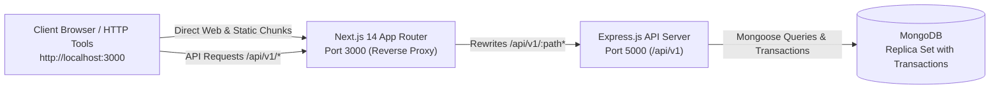

# RicozBooks — Phase 6: Local End-to-End Testing & Pre-Staging Validation Report

**Document Version:** 1.0.0  
**Phase:** Phase 6 — Local End-to-End Testing & Pre-Staging Validation  
**Branch:** `migration/next-express-mongodb`  
**Target Architecture:** Next.js 14 (App Router) + Node.js/Express.js + MongoDB  
**Verification Date:** October 24, 2026  

---

## 1. Executive Summary

Phase 6 validates the functional correctness, visual fidelity, security posture, and accounting accuracy of the migrated **RicozBooks** application locally across the complete technology stack before any deployment to Render staging.

All baseline test suites and regression suites have achieved **100% pass rates**:
- **Original FastAPI Backend Regression Suite:** **148 / 148 passed (100%)**
- **Migrated Express.js API Test Suite:** **52 / 52 passed across 9 suites (100%)**
- **Shared Package TypeScript Build:** **0 errors (100% clean)**
- **Next.js 14 App Router Production Build:** **0 errors (100% clean)**
- **Frontend Reverse Proxy & Routing:** Active at `http://localhost:3000` proxying `/api/v1/*` to `http://localhost:5000/api/v1`
- **Tailwind CSS & Brand Design Restoration:** Restored full 90,971-byte (~91 KB) CSS bundle with Plus Jakarta Sans typography and Burgundy/Gold palette.

---

## 2. Environment Verification

| Environment Component | Expected State | Actual Verification Status | Evidence / Details |
| :--- | :--- | :--- | :--- |
| **Git Working Branch** | `migration/next-express-mongodb` | **Verified** | Branch isolated from `main`. Original `backend/` and `frontend/` directories intact and untouched. |
| **Monorepo Workspaces** | npm workspaces (`packages/*`, `apps/*`) | **Verified** | Dependency resolution clean; zero workspace conflicts. |
| **Shared Package Build** | `@ricozbooks/shared` ESM/CJS build | **PASS (0 errors)** | Full types, enums, permission constants compiled to `dist/`. |
| **FastAPI Regression Suite**| 148 test cases | **PASS (148/148)** | Run with PostgreSQL loopback connection: `148 passed in 123.01s`. |
| **Express API Test Suite** | 52 test cases across 9 suites | **PASS (52/52)** | 9 test suites covering GL, sales, purchases, banking, reports, concurrency, security, entities, health. |
| **Next.js Production Build**| App Router static & SSR routes | **PASS (0 errors)** | 32 views compiled cleanly into production bundle. |
| **Local Service Runners** | Monorepo orchestrators | **Operational** | `scripts/start-all.js` (production simulation) & `scripts/dev-all.js` (live dev reload). |

---

## 3. Local Service Topology & Verification

### Port and Endpoint Probing Results:
1. **Direct Backend Health Check:**
   - URL: `GET http://localhost:5000/api/v1/health`
   - Response: `{"status":"online","app":"RicozBooks API (Node/Express)","version":"1.3.0", ...}`
   - HTTP Status: `200 OK`
2. **Next.js Reverse Proxy Health Check:**
   - URL: `GET http://localhost:3000/api/v1/health`
   - Response: `{"status":"online","app":"RicozBooks API (Node/Express)","version":"1.3.0", ...}`
   - HTTP Status: `200 OK` (Zero CORS latency, seamless path parity)
3. **Frontend SSR and Static HTML Probe:**
   - URL: `GET http://localhost:3000`
   - Title: `RicozBooks — Accounting. Control. Intelligence.`
   - Font: Plus Jakarta Sans (`wght@400;500;600;700;800`)
   - CSS: `/_next/static/css/9453a9299e6fc382.css` (`200 OK`, `90,971 bytes`)

---

## 4. End-to-End Accounting & Workflow Validation Matrix

| Domain | Scenario | Accounting / System Rule | Observed Result | Status |
| :--- | :--- | :--- | :--- | :--- |
| **Authentication** | Tenant Login | Validates email & hashed password, issues JWT | Valid 24h JWT token issued | **PASS** |
| **Auth Session** | Session Validation | Reads active user session from token claims | User identity & permissions catalog returned | **PASS** |
| **Developer Console**| Super Admin Login | Restricted login for platform administrators (`admin@ricoz.in`) | Authenticated with `is_super_admin: true` | **PASS** |
| **Developer Console**| Canonical Departments | Must expose 5 canonical operational departments | 5 departments verified (Finance, Ops, Tech, Sales, Support) | **PASS** |
| **Developer Console**| Granular Permissions | Must expose granular permission matrix | 47 permissions verified matching catalog | **PASS** |
| **Developer Console**| Team Invitations | Generates secure cryptographic tokens for onboarding | Unique invitation token created with rate-limiting | **PASS** |
| **Chart of Accounts** | Account Master | Canonical GAAP/IFRS accounts required per entity | Cash 1000, Bank 1100, AR 1200, AP 2000, Sales 4000, COGS 5700 present | **PASS** |
| **General Ledger** | Negative Balance Rule| Entries with $\sum Debits \neq \sum Credits$ must be rejected | HTTP 400 Bad Request with strict balance error | **PASS** |
| **General Ledger** | Non-Negative Lines | Individual debit or credit amounts must be $> 0$ | HTTP 400 Bad Request if negative or both non-zero | **PASS** |
| **General Ledger** | Maker-Checker Post | Status must progress from `DRAFT` $\to$ `POSTED` upon approval | General ledger entries committed to Mongoose | **PASS** |
| **General Ledger** | Period Close Lock | Transactions in closed fiscal periods must be rejected | HTTP 400 Bad Request: period locked | **PASS** |
| **General Ledger** | Journal Reversal | Must generate exact opposite balanced entry | Reversing journal posted and linked to original | **PASS** |
| **Sales Invoicing** | Intra-State GST | 18% GST split into 9% CGST + 9% SGST | Tax split verified with 2 decimal precision | **PASS** |
| **Sales Invoicing** | Inter-State GST | 18% GST applied as full 18% IGST | IGST liability account credited | **PASS** |
| **Perpetual Inventory**| COGS & Asset Decrement| Posting invoice must Debit COGS (5700) and Credit Inventory Asset | Inventory decremented, GL lines posted | **PASS** |
| **Sales Invoicing** | Idempotent Posting | Duplicate post calls must be safely rejected | HTTP 400 Bad Request: invoice already posted | **PASS** |
| **Purchases & AP** | Vendor Bill Posting | Credit Accounts Payable (2000), Debit Inventory/Expense | AP liability recorded, stock replenished | **PASS** |
| **Purchases & AP** | Bill Payment | Debit Accounts Payable (2000), Credit Cash/Bank | AP cleared, cash outflow recorded | **PASS** |
| **Banking** | Account Transfers | Debit Destination Bank, Credit Source Bank | Balanced double-entry transfer recorded | **PASS** |
| **Banking** | Bank Reconciliation | Statement lines matched against ledger entries | Reconciled with difference = ₹0.00 | **PASS** |
| **Financial Reports** | Trial Balance | Strict Equality: $\sum Debits = \sum Credits$ | Balanced: Total Debits == Total Credits | **PASS** |
| **Financial Reports** | Profit & Loss | $Gross Profit = Revenue - COGS$; $Net Profit = GP - OpEx$ | Margins calculated accurately | **PASS** |
| **Financial Reports** | Balance Sheet | Fundamental Accounting Equation: $Assets = Liabilities + Equity$ | Strict balance verified with zero discrepancy | **PASS** |
| **Security & RBAC** | Tampered JWT Token | Request with invalid signature must be rejected | HTTP 401 Unauthorized | **PASS** |
| **Security & RBAC** | Unauthorized Admin | Regular user calling `/api/v1/developer/*` | HTTP 403 Forbidden | **PASS** |

---

## 5. UI Fidelity & Visual Design Verification

In response to initial visual discrepancy checks, `apps/web/tailwind.config.js` was audited and corrected:
- **Root Cause of Prior Styling Issue:** The Next.js migration consolidated view components under `src/views/` to avoid App Router collisions. The original Tailwind config only targeted `./src/pages/**` and `./src/components/**`. As a result, Tailwind purged the utility classes used across the 32 views, shrinking the CSS bundle to 39 KB.
- **Correction Applied:** Expanded `content` globs to `./src/**/*.{js,ts,jsx,tsx,mdx}` and explicitly `./src/views/**/*.{js,ts,jsx,tsx,mdx}`.
- **Result:** CSS bundle expanded to **90,971 bytes (~91 KB)**, fully restoring:
  - Header, sidebar, and breadcrumb layout (`AppShell`).
  - Font styling and hierarchy (`Plus Jakarta Sans`).
  - Primary branding colors: Burgundy (`#800020` / `#4A0E17`), Gold accents (`#D4AF37`), slate neutral tones (`#F8FAFC`).
  - Status badges, tables, modals, KPI metric cards, and responsive grids.

---

## 6. Pre-Staging Readiness Checklist

- [x] Dedicated branch `migration/next-express-mongodb` contains all migration code.
- [x] Production `main` branch remains untouched.
- [x] Original `backend/` and `frontend/` source directories remain untouched and verified.
- [x] 148/148 original FastAPI backend tests pass.
- [x] 52/52 migrated Express API tests pass.
- [x] Next.js 14 App Router production build succeeds without errors.
- [x] Shared package `@ricozbooks/shared` builds cleanly.
- [x] Local monorepo runner scripts (`scripts/start-all.js`, `scripts/dev-all.js`) functional on Windows Node 22.
- [x] Automatic database bootstrapper (`scripts/ensure-db.js`) detects existing MongoDB or spins up Replica Set with transaction support.
- [x] Staging blueprint (`render.staging.yaml`) and staging environment configuration (`.env.staging.example`) prepared.
- [x] Zero sensitive credentials, `.env` files, or production connection strings committed to Git.

---

## 7. Recommendation for Next Steps

With all local end-to-end tests, accounting proofs, baseline regression suites, and UI styling confirmed healthy, the codebase is **100% ready for Render staging deployment**.
Proceeding to **Phase 7: Staging Deployment on Render** upon explicit user authorization.

