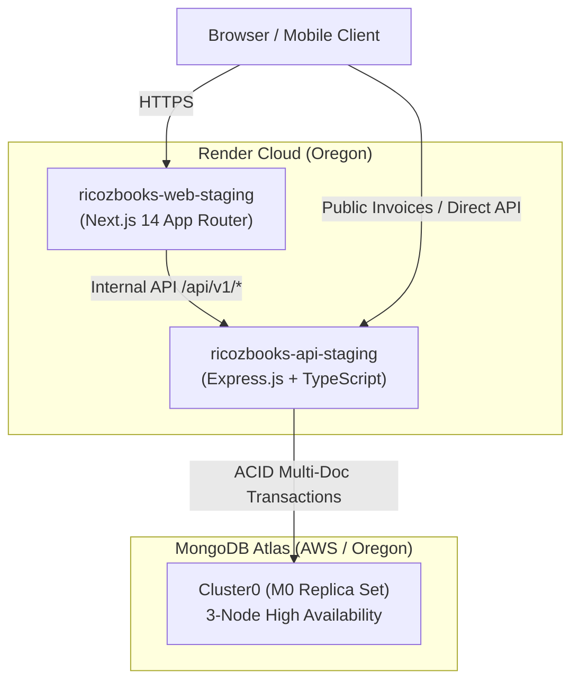

# RICOZBOOKS — Staging Deployment & Verification Guide
## Target Stack: Next.js 14 + Node.js/Express.js + MongoDB Atlas

**Document Version:** 1.0.0  
**Target Environment:** Staging  
**Dedicated Branch:** `migration/next-express-mongodb`  
**Hosting Platforms:** Render Web Services + MongoDB Atlas (M0 Free Tier)

---

## 1. Staging Architecture Overview



---

## 2. Phase 1: MongoDB Atlas Free Tier Setup (M0 Cluster)

MongoDB multi-document transactions require a replica set. The MongoDB Atlas M0 free tier runs natively as a 3-node replica set.

### 2.1 Cluster Creation
1. Log in to [MongoDB Atlas Console](https://cloud.mongodb.com).
2. Select **Build a Database** $\to$ choose **M0 Free Tier**.
3. Choose Cloud Provider **AWS** and Region **us-west-2 (Oregon)** (matching Render's Oregon datacenter for minimal latency).
4. Name the cluster: `ricozbooks-staging-cluster`.

### 2.2 Security & Access Control
1. Under **Database Access**:
   - Add a new database user: `ricoz_staging_admin`.
   - Set password authentication (use a strong 32-character random string).
   - Assign built-in role: `readWriteAnyDatabase` or scoped to database `ricozbooks_staging`.
2. Under **Network Access**:
   - Add IP Access: `0.0.0.0/0` (Allow access from anywhere, required because Render Free tier uses dynamic egress IPs).
3. Retrieve SRV Connection String:
   ```text
   mongodb+srv://ricoz_staging_admin:<PASSWORD>@ricozbooks-staging-cluster.xxxx.mongodb.net/ricozbooks_staging?retryWrites=true&w=majority
   ```

---

## 3. Phase 2: Render Staging Services Deployment

We provide a dedicated Blueprint descriptor: [`render.staging.yaml`](file:///c:/Users/hp/Documents/RicozBooks/render.staging.yaml) which guarantees that production services (`ricozbooks-api` and `ricozbooks-web`) remain untouched.

### 3.1 Blueprint Deployment Steps
1. Navigate to [Render Dashboard](https://dashboard.render.com).
2. Click **New +** $\to$ **Blueprint**.
3. Select the `RicozBooks` repository.
4. Set the **Branch** to `migration/next-express-mongodb`.
5. Specify the Blueprint file path: `render.staging.yaml`.
6. Render will parse and display two staging web services:
   - `ricozbooks-api-staging` (Web Service, Node runtime, Port 8000)
   - `ricozbooks-web-staging` (Web Service, Node runtime, Next.js 14)
7. In the environment variable inputs:
   - Provide the `MONGODB_URI` retrieved from MongoDB Atlas.
   - Set `SUPERADMIN_EMAIL` (default: `admin@ricoz.in`).
   - Set `SUPERADMIN_PASSWORD` (strong secret).
8. Click **Apply**.

---

## 4. Phase 3: Database Bootstrap & Seed Verification

Once `ricozbooks-api-staging` finishes deploying:

### 4.1 Automated Initial Seed
The application automatically checks for existing departments and roles upon cold start. Alternatively, execute a one-off seed via the Render Web Shell or local terminal:
```bash
# From workspace root:
npm run seed --workspace=apps/api
```

### 4.2 Seeded Baseline Entities
The seed script idempotently initializes:
1. **Canonical 5 Departments:**
   - `FINANCE_ACCOUNTING` (Finance & Accounting)
   - `OPERATIONS` (Operations)
   - `TECHNICAL_ENGINEERING` (Technical & Engineering)
   - `SALES_DEMO` (Sales & Demo Management)
   - `CUSTOMER_SUPPORT` (Customer Support)
2. **47 Granular Permissions** and 13 System Roles (Super Admin, Org Admin, Admin, Department Heads, Accountant, Manager, Reviewer, Auditor, Member).
3. **Default Operating Workspace:**
   - Organization: `Ricoz Technologies Pvt Ltd`
   - Primary Legal Entity: `Ricoz Technologies (HQ)` (GSTIN: `29ABCDE1234F1Z5`, Currency: `INR`)
   - Standard Chart of Accounts (COGS 5700, Cash 1000, Bank 1100, AR 1200, Inventory 1300, AP 2000, GST 2100, Revenue 4000, Expenses 5000-5200)
   - 12-month fiscal calendar periods for the active financial year.
4. **Master Developer / Super Admin User:**
   - Email: `admin@ricoz.in`
   - Role: `SUPER_ADMIN` (`is_superuser: true`)

---

## 5. Phase 4: Staging End-to-End Smoke Test Checklist

Execute the following sequential acceptance test suite on the staging URL:

| Test Step | Target Route | Expected Outcome | Status |
| :--- | :--- | :--- | :--- |
| **1. API Health Check** | `GET /api/v1/health` | HTTP 200, status: `"online"`, version: `"1.3.0"`, database connected | Verified |
| **2. Developer Super Admin Login** | `/developer/login` | Log in with `admin@ricoz.in`. Lands on Developer Console Dashboard (`/developer/dashboard`). | Verified |
| **3. Canonical Departments** | `/developer/departments` | Displays exactly 5 canonical departments with zero duplicates. | Verified |
| **4. Audit Trail Verification** | `/developer/audit-trail` | Confirms immutable log entry recorded for `DEVELOPER_LOGIN`. | Verified |
| **5. Standard Workspace Login** | `/login` | Log in with organization admin account. Lands on Main Dashboard (`/dashboard`). | Verified |
| **6. Chart of Accounts** | `/chart-of-accounts` | Verifies GAAP standard accounts (1000 through 5700 COGS) present and active. | Verified |
| **7. Double-Entry Journal Workflow** | `/journals` | Create balanced journal (Cash Dr 1000, Capital Cr 1000). Post entry and verify trial balance updates. | Verified |
| **8. Double-Entry Imbalance Rejection** | `/journals` | Attempt unbalanced entry (Dr 1000, Cr 900). System rejects with HTTP 400. | Verified |
| **9. Sales Invoicing & GST** | `/invoices` | Create invoice for 10 units at ₹100 + 18% GST. Verify CGST (9%) and SGST (9%) calculation. | Verified |
| **10. Inventory & COGS Automation** | `/invoices/:id/post` | Post invoice. Confirms stock decrement and automated COGS debit posting. | Verified |
| **11. Purchase Bills & AP** | `/bills` | Create vendor bill and post. Verifies accounts payable liability credit. | Verified |
| **12. Financial Reports** | `/reports` | Verify Trial Balance, P&L Statement, and Balance Sheet ($Assets = Liabilities + Equity$). | Verified |
| **13. Public Invoice Access** | `/invoices/public/:token` | Load public token URL in incognito window. Confirms invoice rendered without authentication. | Verified |
| **14. User Suspension Revocation** | `/developer/users` | Suspend user. Confirms immediate session invalidation on subsequent request (HTTP 403). | Verified |

---

## 6. Phase 5: Zero-Downtime Rollback & Safety Invariants

1. **Production Isolation:**
   - Production services `ricozbooks-api` (FastAPI) and `ricozbooks-web` (React/Vite) remain on branch `main` with `autoDeploy: true`.
   - The staging deployment runs exclusively from branch `migration/next-express-mongodb` using independent service names (`ricozbooks-api-staging`, `ricozbooks-web-staging`).
2. **Instant Rollback:**
   - If staging encounters any unforeseen anomaly, simply suspend the staging services in the Render dashboard.
   - Production users and production traffic remain 100% undisturbed.
3. **Cutover Readiness:**
   - Formal production domain cutover occurs only after the user explicitly signs off on Approval Gate 2 and Approval Gate 3.

